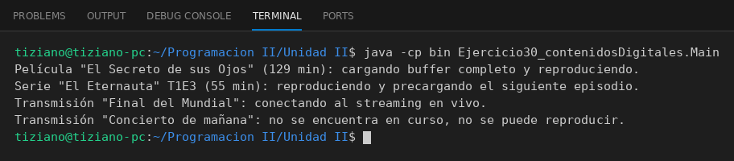

# ContenidoDigital

Programación II - Unidad 2 - Ejercicio 30

## Consigna
Reproducir distintos tipos de contenido desde un reproductor universal.

## Lógica
- Clase abstracta `ContenidoDigital` con `titulo`, `duracionMinutos` y el método abstracto `reproducir()`.
- `Pelicula`, `EpisodioSerie` (temporada y episodio) y `TransmisionEnVivo` reproducen a su manera; esta última valida que la transmisión esté en curso.
- `Main`: catálogo variado recorrido en un bucle.

## Ejecución

